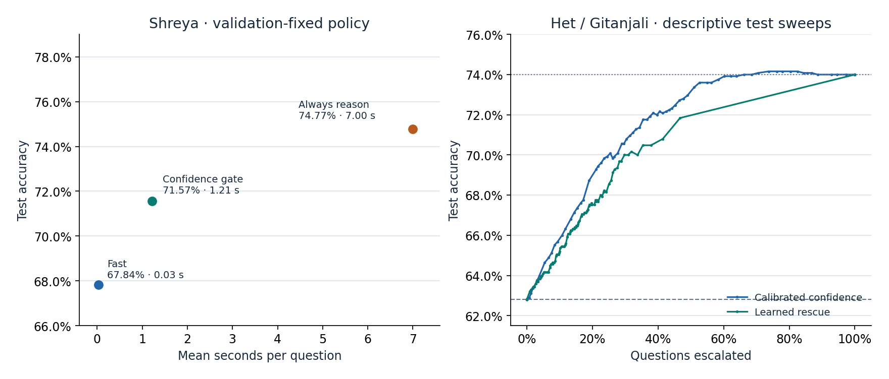
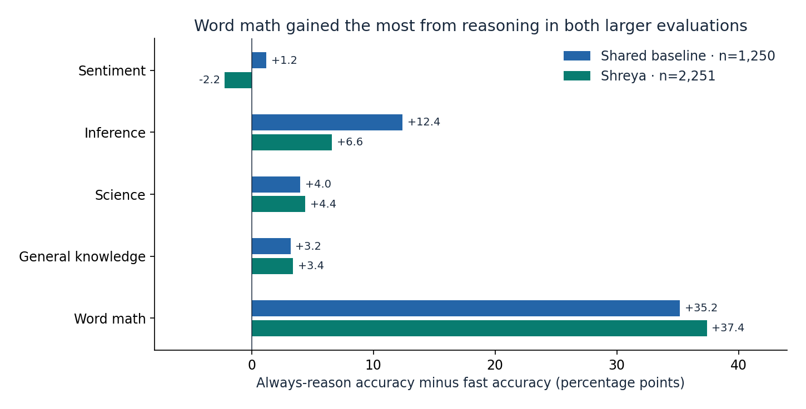
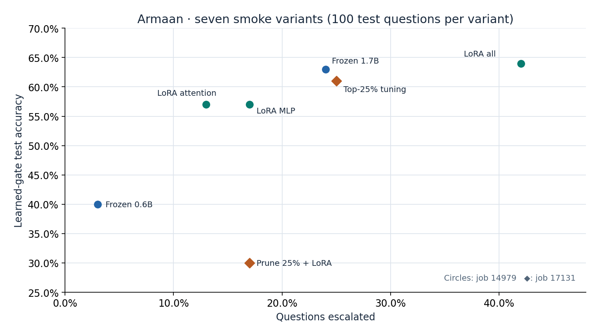

# JEV project analysis

**The project has demonstrated that selective reasoning can improve on fast-only answering while avoiding most reasoning calls. The evidence for shrinking the model while preserving quality is weaker.** Shreya’s validation-selected confidence gate is the strongest timed demonstration. The shared Het–Gitanjali results show why routing matters by task and give calibrated confidence a stronger case than the current learned gate. Het’s Brier penalty is promising for fast-path calibration. Armaan’s frozen 1.7B is the most defensible smoke-run reference, and the tested 25% pruning recipe lost substantial accuracy.

This review compares the checked-in implementation and recorded results. No models were retrained or timed for the review. Accuracy differences are in percentage points (pp). Overall results reflect each run’s task mix. The most informative comparisons use the same test questions within a run.

## What each contributor tested

| Contributor | Code path and experiment design | What the repository establishes |
| --- | --- | --- |
| Shreya | Standalone pipeline. A single Qwen3-1.7B with all-projection LoRA serves both paths. Training combines direct answer cross-entropy with language modeling on teacher traces accepted by final-answer match. A threshold on raw fast confidence minimizes validation escalation subject to a target accuracy gap from always reasoning. The test loop measures a fast pass and executes a reasoning tail when routed. | 2,251 scored questions. A validation-fixed threshold at 0.82 with a timed test comparison against fast-only and always-reason. |
| Gitanjali | Executed notebook with Qwen3-1.7B, a configured 4B trace teacher, all-projection LoRA, validation-fitted temperatures, and a logistic gate trained to predict when reasoning corrects a fast error. Gate inputs are four raw-probability/option features and the 2,048-value final hidden state. The fitted gate is exported as portable coefficients and scaler parameters. | 1,250 scored questions, an internal validation holdout for the rescue classifier, and descriptive test sweeps for confidence and learned routing. |
| Het | The same baseline notebook and saved results, plus a follow-up that reuses saved splits and 345 accepted traces. It trains a fresh LoRA adapter with a multiclass Brier penalty of 1.0 added to answer and trace losses, then fits temperatures again. | A matched-test comparison of fast and reasoning accuracy and calibration. The baseline trained for two epochs and the Brier variant for one, so the effects of the penalty and training duration are confounded. No gated Brier result was saved. |
| Armaan | CLI and Slurm pipeline comparing frozen 1.7B and 0.6B, all/attention/MLP LoRA, tuning the top seven blocks, and evenly pruning seven blocks followed by LoRA. It fits temperatures and compares confidence with a rescue gate using 35 hidden-state summary features plus four scalar features. It selects thresholds by validation accuracy minus 0.02 × escalation fraction. | Seven usable smoke variants across two jobs. The corrected top-layer and pruning results come from job 17131. The full-data launcher exists, with no saved full-data result in this checkout. |

The Het and Gitanjali baseline notebooks have identical source in all 23 cells. Their final tables, results, temperatures, gate sweeps, and headline escalation files are byte-identical. They are one body of baseline evidence. The notebooks, pipelines, and result files are linked throughout this report.

Code reviewed: [Shreya pipeline](../../Shreya/run_jev_hpc_pipeline.py) · [Gitanjali executed notebook](../../Gitanjali/JevLikeReasoningModel/notebooks/current_jev_executed.ipynb) · [Het baseline notebook](../../het/github_ready/source/current_jev.ipynb) · [Het Brier notebook](../../het/github_ready/brier_experiment.ipynb) · [Armaan pipeline](../train_jev_efficiency_experiments.py)

## Selective reasoning

### Strongest timed result: Shreya’s confidence gate

| Policy on the same 2,251 questions | Accuracy | Questions escalated | Generated tokens/question | Mean seconds/question |
| --- | ---: | ---: | ---: | ---: |
| Fast only | 67.84% | 0% | 0.00 | 0.031 |
| Validation-selected confidence gate | 71.57% | 17.01% | 43.56 | 1.214 |
| Always reason | 74.77% | 100% | 256.00 | 6.997 |

The gate gained **3.73 pp** over fast-only and finished **3.20 pp** below always-reason. Mean measured latency was **5.76× lower than the always-reason timing baseline** and reasoning calls fell by **82.99%**. The gate delivered **95.72% of always-reason accuracy** (71.57 ÷ 74.77) and recovered **53.85% of the accuracy gain** over fast-only. These are different denominators. The saved 17.01% escalation also explains the 82.99% reduction in generated reasoning tokens at the 256-token cap. The run does not measure FLOPs or energy.

The validation target was a gap of 3 pp. The observed gap was 2.99 pp on validation at 22.32% escalation and 3.20 pp on test at 17.01% escalation. The test timings sum the measured fast and tail times for routed examples. The always-reason timing includes an initial fast pass in this implementation. The code uses CUDA synchronization for recorded inference times. The forward-call counter wraps the outer model object, and the saved always-reason count averages 2 despite generating 256 tokens, so it cannot serve as a decoder-step or compute count. [Metrics and threshold](../../Shreya/efficiency.json) · [Timing and routing code](../../Shreya/run_jev_hpc_pipeline.py#L585)

### Confidence versus learned routing: shared baseline

The shared LoRA baseline delivered 62.80% fast accuracy and 74.00% always-reason accuracy. On the saved **test sweep**, calibrated confidence gave better accuracy than learned rescue at the sampled escalation budgets below. Each column gives the most accurate saved point at or below the budget, with actual escalation in parentheses.

| Escalation budget | Calibrated confidence | Learned rescue |
| ---: | ---: | ---: |
| 17% | 67.60% (16.40%) | 67.04% (16.80%) |
| 25% | 69.92% (24.48%) | 68.24% (23.60%) |
| 33% | 71.12% (32.40%) | 70.16% (31.84%) |
| 50% | 72.96% (48.96%) | 71.84% (46.72%) |

The separate confidence-ranking analysis reaches within 3 pp of always-reason at 32.96% escalation and within 1 pp at 50.00%. It sorts individual examples, which allows different operating points from the threshold grid. The confidence sweep reaches 74.16% at 73.76% escalation, a two-answer difference versus always reasoning, after inspecting test thresholds. Treat all these sweep points as exploratory. A validation-selected threshold on a held-out test set is needed to show which gate wins. The learned gate’s rescue target also groups “both correct,” “both wrong,” and “reasoning harms a correct fast answer” into one class. That target differs from predicting the net benefit of escalation. [Saved sweeps](../../Gitanjali/JevLikeReasoningModel/results/metrics/gate_sweeps.json) · [Confidence-ranking rates](../../Gitanjali/JevLikeReasoningModel/results/metrics/headline_escalation_rates.json) · [Gate artifact specification](../../Gitanjali/JevLikeReasoningModel/results/metrics/learned_gate_README.md)

### Where reasoning pays off

| Task | Shared baseline fast → reason (250/task) | Shreya fast → gate → reason | Shreya routed |
| --- | ---: | ---: | ---: |
| Sentiment | 93.20% → 94.40% | 93.76% → 93.76% → 91.55% | 0.60% |
| Inference | 55.60% → 68.00% | 61.20% → 62.00% → 67.80% | 10.80% |
| Science | 83.20% → 87.20% | 82.40% → 84.20% → 86.80% | 7.60% |
| General knowledge | 56.40% → 59.60% | 56.60% → 57.00% → 60.00% | 19.20% |
| Word math | 25.60% → 60.80% | 23.62% → 50.79% → 61.02% | 75.59% |

Word math showed the largest gain from always reasoning in both evaluations (+35.20 and +37.40 pp). Shreya’s gate recovered 27.17 pp on math while leaving a 10.24 pp gap to always-reason. It also left a 5.80 pp gap on inference. Sentiment had little upside from reasoning, and Shreya’s always-reason path lost 2.21 pp there. Shreya’s run has 497 sentiment, 500 each for inference, science and general knowledge, and 254 math questions. Giving tasks equal weight changes its overall fast/gated/reason accuracies to **63.52% / 69.55% / 73.43%**, versus **67.84% / 71.57% / 74.77%** by example. Word math is held out from adapter training in both implementations. Shreya’s threshold selection includes word-math validation examples, while the shared notebook excludes word math from fitting both the temperatures and the learned gate. [Shreya task table](../../Shreya/final_table.csv) · [Shared task table](../../Gitanjali/JevLikeReasoningModel/results/metrics/final_table.csv) · [Shreya threshold code](../../Shreya/run_jev_hpc_pipeline.py#L745)

## Calibration: Het’s Brier penalty

| Mode and objective | Accuracy | ECE ↓ | NLL ↓ | Brier ↓ |
| --- | ---: | ---: | ---: | ---: |
| Fast, baseline | 62.80% | 0.0830 | 0.8938 | 0.4715 |
| Fast, Brier penalty | 63.36% | 0.0449 | 0.8613 | 0.4539 |
| Reasoning, baseline | 74.00% | 0.0558 | 0.7619 | 0.3889 |
| Reasoning, Brier penalty | 73.28% | 0.0586 | 0.7391 | 0.3791 |

The Brier variant is the best saved **fast calibration** result in the matched comparison. Fast ECE fell by about 46%, and fast NLL and Brier both improved on all five tasks. Fast accuracy rose by seven answers (+0.56 pp). Reasoning lost nine answers (−0.72 pp), with lower NLL and Brier but slightly higher ECE. Word-math reasoning lost 2.80 pp while general knowledge gained 2.40 pp. Post-temperature calibration metrics describe how well the probabilities match outcomes. They do not establish whether confidence ranks the questions most worth escalating. An equal-epoch loss ablation with a fixed validation routing protocol would test that directly. [Matched results](../../het/github_ready/brier_outputs/metrics/comparison_original_vs_brier.csv) · [Brier run documentation](../../het/github_ready/README.md)

## Adaptation and compression: Armaan’s smoke results

| Variant (job) | Fast | Reason | Learned gate | Escalation | Gate tokens/question | Mean gate seconds | Trained params |
| --- | ---: | ---: | ---: | ---: | ---: | ---: | ---: |
| Frozen 1.7B (14979) | 55% | 69% | 63% | 24% | 61.4 | 0.892 | 0 |
| Frozen 0.6B (14979) | 39% | 51% | 40% | 3% | 7.7 | 0.118 | 0 |
| LoRA all (14979) | 53% | 69% | 64% | 42% | 107.5 | 2.942 | 17.43M |
| LoRA attention (14979) | 54% | 67% | 57% | 13% | 33.3 | 0.834 | 6.42M |
| LoRA MLP (14979) | 53% | 69% | 57% | 17% | 43.5 | 0.982 | 11.01M |
| Top-25% tuning (17131) | 54% | 69% | 61% | 25% | 64.0 | 0.916 | 352.45M |
| Prune 25% + LoRA (17131) | 26% | 27% | 30% | 17% | 43.5 | 0.881 | 13.07M |

- **Best quality–cost starting point: frozen 1.7B.** The highest gated score was all-projection LoRA at 64%, one extra correct answer versus frozen 1.7B, with 18 pp more escalation and 46.1 more generated tokens per question. Frozen 1.7B also matched its always-reason accuracy without training.
- **Best targeted adapter at the recorded gate settings: attention-only LoRA.** It tied MLP LoRA at 57% gated accuracy with fewer trainable parameters, fewer escalations, and fewer tokens. This compares two selected operating points. A matched-budget test could change their order. The 0.6B is the lowest-cost measured model here, with a steep quality trade-off at 40% gated accuracy.
- **Top-layer tuning has little support from this smoke comparison.** Job 17131 loaded the correct checkpoint, trained 352.45M parameters, and retained all 28 blocks. Its 61% gate score compares with 63% for the frozen reference from job 14979. Jobs 14662 and 14979 evaluated the frozen checkpoint under the top-layer recipe, and 14979 stopped before pruning trained.
- **25% pruning reduced size and sharply hurt quality.** In corrected job 17131 it reduced the backbone from 28 to 21 blocks and total parameters from 1.721B to 1.381B (about 19.7%). Against top-layer tuning in the same job, always-reason fell from 69% to 27% and gated accuracy from 61% to 30%. Science gated accuracy fell from 16/20 to 5/20. Always-reason timing was 5.109 s for pruning versus 3.614 s for top-layer tuning. Their gated timings used different escalation rates. These results provide no evidence of a speedup at matched quality.

Armaan recombines saved fast/reasoning predictions to score the gate. Current v1.6 reasoning time includes the initial fast pass, but the aggregate selects premeasured path durations and does not time the gate as a live system. The learned gate is fit and thresholded on the same seen-task validation predictions, so its fit diagnostics are in-sample even though the test is separate. The archived runs use one seed and 20 questions per task. One answer changes a task score by 5 pp; small method gaps and single-run timings should be treated accordingly. [Variant comparison](../efficiency_variant_comparison.md) · [14662 audit](../jev_efficiency_results/14662/analysis.md) · [14979 audit](../jev_efficiency_results/14979/analysis.md) · [17131 audit](../jev_efficiency_results/17131/analysis.md)

## What to carry forward

1. **Use Shreya’s confidence gate as the timed reference and Armaan’s frozen 1.7B as the no-training reference.** Run both on the same frozen example IDs and option order. Compare tuned and frozen backbones, fast-only, reasoning-only, confidence routing, and learned routing at the same escalation budgets. Use seen-task validation for threshold choice if claiming transfer to unseen math.
2. **Test whether the Brier objective actually improves routing.** Hold the training duration and configuration fixed, fit each temperature on the same validation split, and compare accuracy at matched escalation. Include a confidence-only gate and a learned gate with an independent threshold-selection fold. Report calibration and the rates at which reasoning rescues or harms fast answers.
3. **Treat compression as an open research question.** Compare the frozen 0.6B, frozen 1.7B, and a milder depth reduction such as 10–15%, keeping inference settings fixed. LoRA addresses trainable parameters and adapter storage. Block pruning and smaller pretrained models change inference size. Measure throughput, latency, and peak memory at matched accuracy before promoting a compression recipe.
4. **Make the next run auditable end to end.** Archive split IDs, per-example paired outcomes, run configuration, model/checkpoint identity, and code revision. Shreya’s validation and test caches are reused by path, so start with a clean cache or verify its provenance before comparing models or thresholds. Armaan’s launchers execute the cluster copy under `~/jev`, and the four-hour full launcher runs all variants in one allocation. Verify the cluster code revision and plan the workload against that cap. Use paired uncertainty intervals and multiple seeds. Report both equal-task and per-example accuracy, cap-hit rates, and consistent timings with an independently timed reasoning-only baseline. [Shreya pipeline](../../Shreya/run_jev_hpc_pipeline.py#L745) · [Armaan full launcher](../run_jev_full.sh)

The missing per-example predictions, checkpoints, and raw timing logs limit independent verification and paired uncertainty estimates. In particular, this checkout contains only the audit and configuration for job 17131. The report uses its recorded summary. The larger runs have different sampled questions, task weights, training data, calibration policies, and timing definitions, so their headline scores do not support a single cross-team leaderboard.
