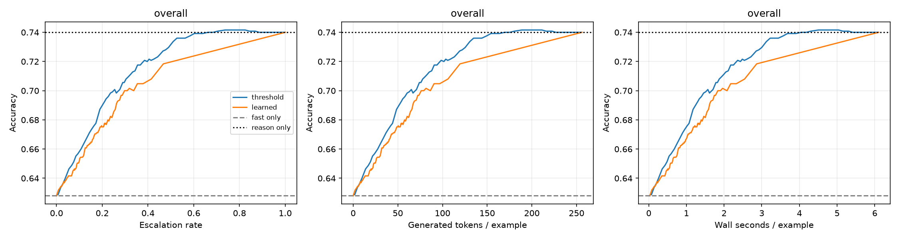
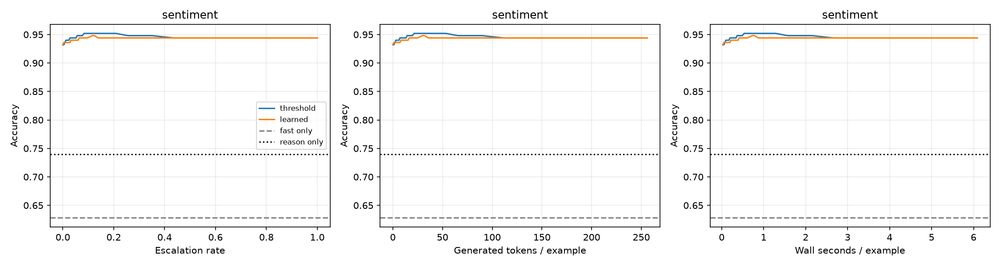
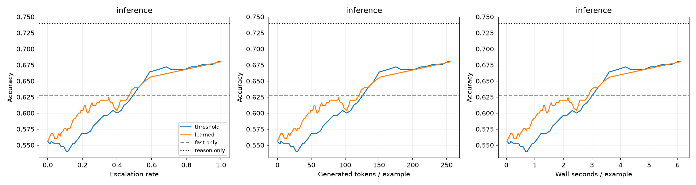
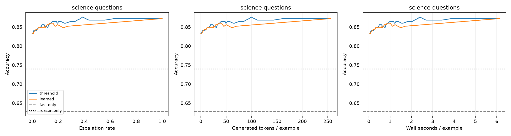
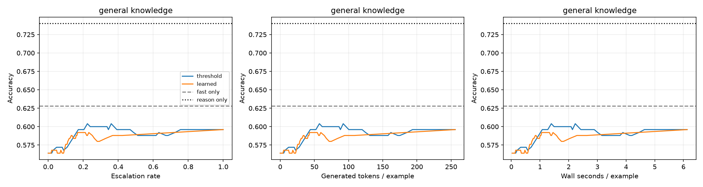
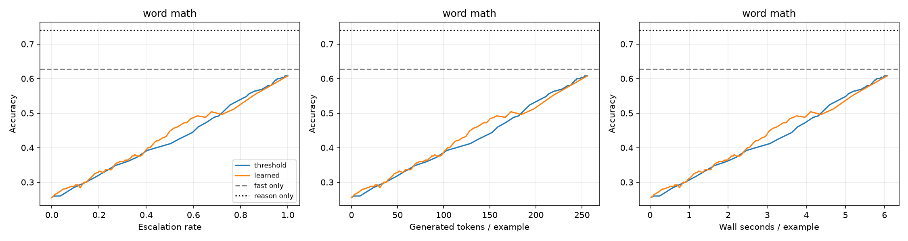
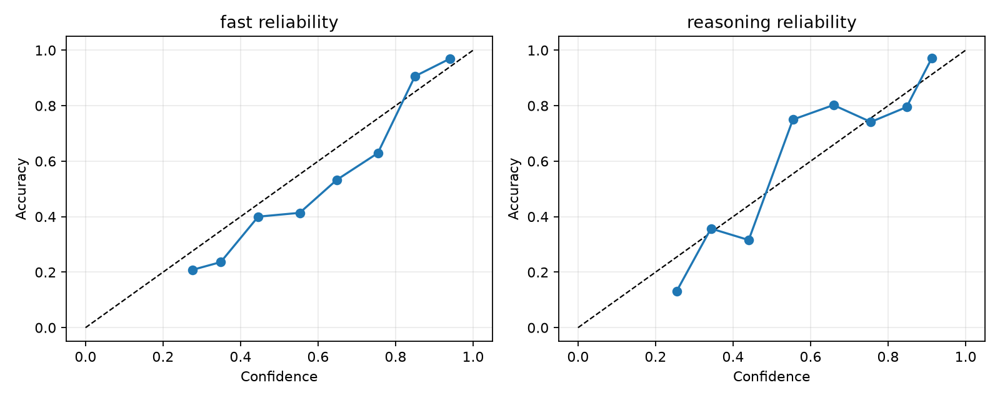

# JevLikeReasoningModel

A university research project exploring whether a language model can use a lightweight gate to decide when additional reasoning is worth its inference cost. The experiment compares restricted multiple-choice predictions from a fast mode and a reasoning mode, then studies selective escalation across five task types.

This repository contains an **executed experiment record** and selected result artifacts. It does not include the sampled benchmark splits, teacher traces, large prediction dumps, language-model weights, or LoRA training checkpoints.

## Motivation and problem

Reasoning-style generation can improve answers on some examples, but it incurs extra tokens and latency. Running that mode for every input may be unnecessary; deciding from fast-mode confidence alone may also miss cases where fast predictions are confidently wrong.

This project investigates a Jev-like escalation setup: obtain a fast answer distribution, derive features from that distribution and its hidden representation, and use a learned gate to estimate whether reasoning will correct a fast-mode error. When a policy escalates, the reasoning-mode distribution supplies the answer; otherwise the fast-mode distribution does. The experiment measures answer quality alongside calibration and inference cost. It is an empirical study, not a claim that the gate generalizes beyond the evaluated setting.

## Tasks and datasets

The notebook loads these Hugging Face datasets and maps their fields to a shared option-and-label format:

| Task | Dataset/configuration | Task form |
|---|---|---|
| Sentiment | `stanfordnlp/sst2` | Positive/negative review classification |
| Inference | `facebook/anli` | Entailment, neutral, or contradiction |
| Science questions | `allenai/ai2_arc`, `ARC-Challenge` | Grade-school science multiple choice |
| General knowledge | `cais/mmlu`, `all` | Multiple-choice exam questions |
| Word math | `deepmind/aqua_rat`, `raw` | Multiple-choice math word problems |

The experiment samples 500 training, 150 validation, and 250 test examples per task. The notebook partitions SST-2's validation split into separate validation and test pools. Word math is held out from training, teacher-trace generation, temperature fitting, and gate fitting; it is evaluated as an unseen task. Split examples and traces were excluded from this publication folder. Dataset access and redistribution remain subject to each dataset's terms.

## Method

1. **Canonicalize data.** Dataset-specific mappings normalize questions, options, and labels. Options are deterministically shuffled; hashed example IDs and overlap assertions are used for split checks.
2. **Fast prediction.** The model produces a probability distribution restricted to the valid answer-letter token IDs, along with the fast prompt's final hidden-state vector.
3. **Reasoning prediction.** The prompt requests a reasoning scratch trace, then a typed final answer. The model's final answer remains a restricted distribution over valid option letters. Reasoning generation is capped at 256 tokens.
4. **Teacher traces.** The Qwen3 4B teacher generates traces for examples from the four seen tasks. The notebook accepts a trace only when its parsed final answer matches the label. The accepted traces are used during fine-tuning; they are not included here.
5. **LoRA fine-tuning.** A shared adapter is trained on direct-answer examples and accepted reasoning examples. The training objective combines restricted answer loss with language-model loss on trace content; prompt tokens are masked from the trace loss.
6. **Calibration.** Fast and reasoning temperatures are fitted on seen-task validation examples and applied to validation and test probabilities. The held-out word-math task does not contribute to temperature fitting.
7. **Gate fitting.** A standard-scaled logistic regression is trained to predict a rescue event: fast mode is wrong and reasoning mode is correct. Its fitted portable parameters are in [`learned_gate.json`](results/metrics/learned_gate.json), with the feature specification and reconstruction steps in [`learned_gate_README.md`](results/metrics/learned_gate_README.md).
8. **Evaluation.** Test predictions are summarized by accuracy, expected calibration error (ECE), negative log-likelihood (NLL), and multiclass Brier score. Escalation sweeps report accuracy, escalation rate, average generated tokens, and average elapsed seconds. Saved sweeps and plots are descriptive analyses on the test set; they should not be used to choose a policy and then reported as an independent test estimate.

## Models and training configuration

- Base model: `Qwen/Qwen3-1.7B`
- Fallback tokenizer/model: `Qwen/Qwen3-0.6B` if primary model loading fails
- Trace teacher: `Qwen/Qwen3-4B` (the notebook allows setting `TEACHER=None`)
- Seed: `2026`
- Trace target: 345 accepted examples at most, sampled from the four seen tasks
- Fine-tuning: 2 epochs, learning rate `2e-4`, maximum sequence length 1,024
- LoRA: rank 16, alpha 32, dropout 0.05; attention and MLP projection targets discovered from model modules
- Batch size: 1 per device, gradient accumulation 8 in the full run
- Precision: fp16 when CUDA is available
- Maximum reasoning generation: 256 tokens

The notebook source reports PyTorch `2.11.0+cu128` in the executed environment on an NVIDIA RTX PRO 6000 Blackwell Server Edition MIG device. The notebook describes its defaults as targeting a Colab T4. Device availability, memory, runtime, and package compatibility affect whether the full experiment can run as recorded.

## Results

The following values come from [`final_table.csv`](results/metrics/final_table.csv) and [`results.json`](results/metrics/results.json). Each task has 250 test examples; the overall row contains 1,250. Accuracy, ECE, NLL, and Brier are computed from calibrated probabilities. Values below are rounded to four decimal places from the saved metrics.

| Task | n | Fast accuracy | Reasoning accuracy | Fast ECE | Reasoning ECE | Fast NLL | Reasoning NLL | Fast Brier | Reasoning Brier |
|---|---:|---:|---:|---:|---:|---:|---:|---:|---:|
| Sentiment | 250 | 0.9320 | 0.9440 | 0.0420 | 0.0472 | 0.2150 | 0.2236 | 0.1132 | 0.1090 |
| Inference | 250 | 0.5560 | 0.6800 | 0.1676 | 0.0872 | 1.0009 | 0.8634 | 0.6014 | 0.4948 |
| Science questions | 250 | 0.8320 | 0.8720 | 0.0871 | 0.1304 | 0.5124 | 0.5436 | 0.2505 | 0.2446 |
| General knowledge | 250 | 0.5640 | 0.5960 | 0.0967 | 0.1309 | 1.0777 | 1.1445 | 0.5729 | 0.6068 |
| Word math | 250 | 0.2560 | 0.6080 | 0.1277 | 0.1819 | 1.6631 | 1.0345 | 0.8193 | 0.4892 |
| **Overall** | **1,250** | **0.6280** | **0.7400** | **0.0830** | **0.0558** | **0.8938** | **0.7619** | **0.4715** | **0.3889** |

In these saved results, reasoning mode has higher accuracy in all five task groups. Calibration metrics vary by task: for example, reasoning mode has lower ECE on inference but higher ECE on science questions. These are measured outcomes on this sampled run, not evidence of general performance across dataset versions or deployment settings.

The saved headline rates report the escalation fraction from a confidence-ranked policy needed to come within one or three accuracy points of the reasoning-only endpoint. Overall, those rates are 0.5000 and 0.3296, respectively. Per-task rates are in [`headline_escalation_rates.json`](results/metrics/headline_escalation_rates.json). They are test-set descriptive values and should be interpreted with that limitation.

## Result plots

### Overall



### By task

| Sentiment | Inference |
|---|---|
|  |  |

| Science questions | General knowledge |
|---|---|
|  |  |

| Word math | Reliability |
|---|---|
|  |  |

## Learned gate artifact

The classifier predicts the rescue label (`1` means fast mode is incorrect and reasoning mode is correct). Its 2,052 features are ordered as follows: maximum raw fast probability, top-two raw probability margin, entropy of the raw fast probabilities, option count, then the 2,048 values of the fast prompt's final hidden state. The portable JSON stores the fitted StandardScaler arrays and settings, LogisticRegression coefficients, intercept, classes, feature count, and estimator parameters.

See [`results/metrics/learned_gate_README.md`](results/metrics/learned_gate_README.md) for the exact feature definitions and prediction reconstruction formula. The JSON avoids loading a pickle, but constructing the input still requires the same model-specific hidden state and feature order.

## Repository structure

```text
Gitanjali/JevLikeReasoningModel/
├── README.md
├── notebooks/
│   └── current_jev_executed.ipynb
└── results/
    ├── metrics/
    │   ├── final_table.csv
    │   ├── gate_sweeps.json
    │   ├── headline_escalation_rates.json
    │   ├── learned_gate.json
    │   ├── learned_gate_README.md
    │   ├── results.json
    │   └── temperatures.json
    └── plots/
        ├── gate_general_knowledge.png
        ├── gate_inference.png
        ├── gate_overall.png
        ├── gate_science_questions.png
        ├── gate_sentiment.png
        ├── gate_word_math.png
        └── reliability.png
```

The sampled data splits, teacher traces, prediction dumps, pickle gate, model weights, and training checkpoints are not part of this contribution.

## Reproduction

The notebook is an **executed experiment record**, not a packaged command-line application. Its source cells describe the full workflow, but rerunning may require environment and path adjustments. In particular, the notebook writes to an absolute `/scratch/...` path; set `ROOT` to a writable experiment directory before running. The run also depends on external downloads and substantial compute. No trained adapter or model checkpoint is included, so the fine-tuning stage must be reproduced to regenerate tuned-model results unless the required adapter is obtained separately.

A reproduction workflow is:

1. Use a Python 3.11 environment with Jupyter and install compatible versions of PyTorch, NumPy, pandas, Matplotlib, Hugging Face `datasets` and `transformers`, `peft`, scikit-learn, and SciPy. The repository does not pin package versions; install a PyTorch build compatible with the available CUDA runtime, or use CPU only for a smaller/slow run.
2. Ensure access to Hugging Face Hub and enough disk space to download the datasets and model weights. The notebook loads the five dataset IDs/configurations listed above and Qwen3 1.7B/0.6B/4B model variants.
3. Open `notebooks/current_jev_executed.ipynb`, adjust `ROOT` and any environment-specific settings, then execute cells from top to bottom. Set `SMOKE_TEST=True` only for a reduced smoke run; its results are not comparable to the full saved experiment.
4. Reserve a CUDA GPU with sufficient memory for model loading and fine-tuning. The executed run used a GPU-backed environment; CPU execution will be substantially slower and may require code adjustments.

The code checkpoints long-running predictions and teacher traces under `ROOT`, but those saved artifacts are not included here. Dataset versions, model revisions, package versions, hardware, and runtime can change results. The evaluated sample sizes are modest, and the gate's hidden-state features are tied to the specified model and prompting setup.

## Limitations and future work

The saved experiment supports comparison of fast and reasoning modes within this particular sampled setup. It does not establish that the learned gate generalizes across model families, dataset revisions, prompting changes, or production latency conditions. Test-set escalation sweeps are descriptive and are not an independent policy-selection evaluation. Further work could evaluate a gate with thresholds selected only on validation data, repeat runs across seeds, and test additional models and data; these are proposed next steps, not results reported here.
