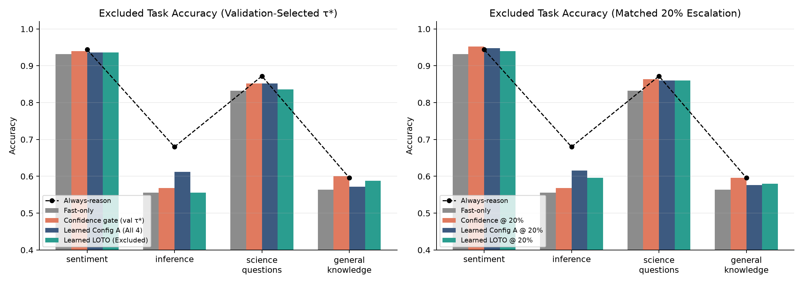
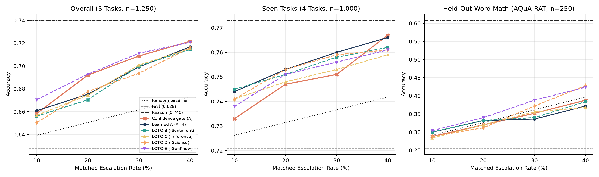
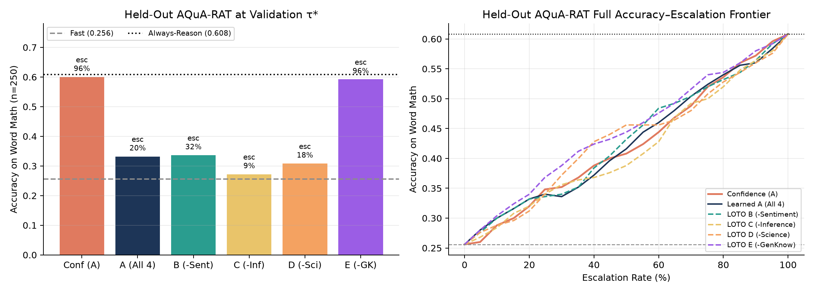
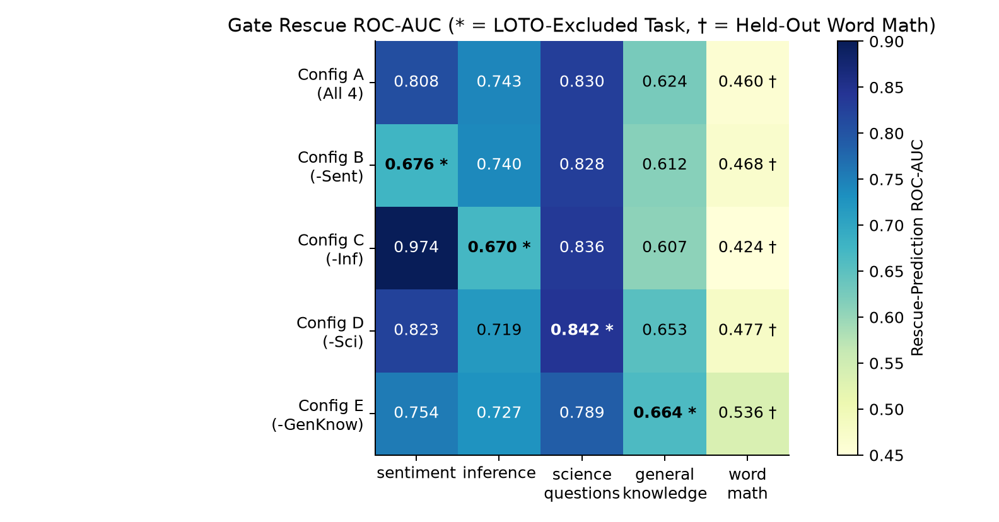

# JEV — Generalisation of Learned Escalation Gate to Unseen Tasks (LOTO Study)

## 1. Research Objective

This experiment investigates a core generalisation question in selective reasoning cascades (**JEV**):

> **Can a learned escalation gate trained on a subset of reasoning tasks reliably generalise to tasks excluded from gate training—both seen-family Leave-One-Task-Out (LOTO) tasks and completely held-out word mathematics (`AQuA-RAT`)?**

Specifically, we evaluate whether a 2,052-feature logistic regression gate trained to predict **rescue events** (cases where System 1 / fast mode is incorrect and System 2 / reasoning mode is correct) transfers across task boundaries, or whether it overfits to task-specific hidden-state geometry and option counts compared with a simple confidence-based escalation baseline.

---

## 2. Background and Motivation

In the JEV two-stage inference framework, a single language model (`Qwen/Qwen3-1.7B` with a shared LoRA adapter) answers queries either via a single forward pass (**Fast Mode**, 0 generated tokens, ~29 ms) or via chain-of-thought generation (**Reasoning Mode**, 256 tokens, ~6.1 s). Because reasoning is ~200× slower than fast readout—and can occasionally hurt accuracy on easy tasks—an escalation gate must decide per query when reasoning is worthwhile.

Prior work in this repository left two methodological gaps:
1. **Unassessed cross-task gate generalisation**: The learned logistic gate in `Gitanjali/JevLikeReasoningModel` was trained on all four seen tasks (`sentiment`, `inference`, `science questions`, `general knowledge`) and never tested under Leave-One-Task-Out task exclusion.
2. **Threshold/training overlap & test-set sweeps**: `Gitanjali/JevLikeReasoningModel` fitted temperature scaling and the gate on the same `seen_val` pool and plotted descriptive test-set sweeps rather than selecting a fixed validation threshold; `Armaan_R` optimized the gate threshold on the exact training rows used to fit the logistic regression; and `Shreya` calibrated confidence thresholds on a validation pool that included `word math`.

This study resolves both gaps by enforcing a **strict 4-way disjoint partition** (`val_temp`, `val_gate_train`, `val_thresh`, `test`), evaluating all five LOTO configurations (`A`–`E`), comparing against confidence-based and random baselines at **matched escalation rates (`10%, 20%, 30%, 40%`)**, and verifying stability across 5 random partition seeds plus an untuned Stage-0 backbone control.

---

## 3. Existing JEV Implementation Used

- **Source implementation**: [`Gitanjali/JevLikeReasoningModel`](../Gitanjali/JevLikeReasoningModel/) ([`notebooks/current_jev_executed.ipynb`](../Gitanjali/JevLikeReasoningModel/notebooks/current_jev_executed.ipynb), executed Slurm run `current-jev-14894` / `nanbugfix_medium`, Nov 18–19, 2026).
- **Reused frozen artifacts** (external local prediction cache, excluded from Git):
  - `stage2_val.json` (750 validation predictions, raw fast/reasoning probabilities + 2,048-d fast hidden states from LoRA-tuned `Qwen/Qwen3-1.7B`)
  - `stage5_test.json` (1,250 test predictions across all 5 tasks)
  - `stage0_val.json` and `stage0_test.json` (untuned base `Qwen/Qwen3-1.7B` predictions used as a zero-shot backbone control)
- **Why `stage3_val_calibrated.json` and `temperatures.json` were NOT reused directly**: They were calibrated using temperatures fitted on all four seen tasks and overlapping validation rows. To prevent any task or partition leakage, we start strictly from raw uncalibrated probabilities (`stage2_val.json`, `stage5_test.json`) and re-fit temperatures inside each configuration's isolated `val_temp` split.
- **Full repository audit**: See [`documentation/repository_audit.md`](documentation/repository_audit.md) for the complete 14-point audit of `Armaan_R/`, `Shreya/`, and `Gitanjali/`.

---

## 4. Dataset Details and Exact Splits

All five tasks follow the canonical splits generated in `Gitanjali/JevLikeReasoningModel` (`SEED = 2026`):

| Task | HF Dataset / Config | Role | Options (`n_options`) | LoRA Train | Accepted Traces | Raw Val | Unique Val (`val_temp` / `val_gate_train` / `val_thresh`) | Test (`n`) |
| :--- | :--- | :--- | :---: | :---: | :---: | :---: | :---: | :---: |
| `sentiment` | `stanfordnlp/sst2` | Seen | 2 | 500 | 98 | 150 | 150 (`30 / 75 / 45`) | 250 |
| `inference` | `facebook/anli` (`r1`) | Seen | 3 | 500 | 78 | 150 | 150 (`30 / 75 / 45`) | 250 |
| `science questions` | `allenai/ai2_arc` (`ARC-Challenge`) | Seen | 3–5 | 500 | 80 | 150 | 150 (`30 / 75 / 45`) | 250 |
| `general knowledge` | `cais/mmlu` (`all`) | Seen | 4 | 500 | 89 | 150 | **149*** (`30 / 74 / 45`) | 250 |
| `word math` | `deepmind/aqua_rat` (`raw`) | **Held-out** | 5 | 0 | 0 | 150 | **0** (strictly excluded) | 250 |
| **Total** | — | — | 2–5 | **2,000** | **345** | **750** | **599** (Config A) / **449–450** (B–E) | **1,250** |

\* **Data hygiene note**: Verification (`scripts/verify_inputs.py`) detected one exact duplicate SHA-256 content ID (`82b95ba4edfb`) appearing twice in `general knowledge` validation (`stage2_val.json` and `stage0_val.json`). Deduplicating by `id` before partitioning guarantees zero cross-partition overlap across all random seeds (`val_temp`, `val_gate_train`, `val_thresh`, and `test` have `0` shared IDs).

---

## 5. Model Configurations

The underlying language model weights remain **completely frozen** across all gate experiments:
- **Base model**: `Qwen/Qwen3-1.7B` (1,720,574,976 base params; 1,738,007,552 with LoRA).
- **LoRA adapter** (frozen from `Gitanjali` run): `r = 16`, `alpha = 32`, `dropout = 0.05` on all 7 linear projections (`q_proj`, `k_proj`, `v_proj`, `o_proj`, `gate_proj`, `up_proj`, `down_proj`; `17,432,576` trainable params, `1.0030%`), trained for `2` epochs (`lr = 2e-4`, effective batch `8`, `max_seq_len = 1024`, `fp16`) using `ReadoutTrainer` (`lm_loss + answer_loss`) with 345 `Qwen/Qwen3-4B` teacher traces.
- **Fast inference**: Single forward pass at `Answer:`, restricted softmax over single-token option IDs `{'A': 362, 'B': 425, 'C': 356, 'D': 422, 'E': 468}`[:`n_options`], `0` generated tokens, `0.0288 s` mean test latency.
- **Reasoning inference**: Greedy decoding (`do_sample = False`) at `Answer:\nReasoning:` capped at `MAX_REASON_TOKENS = 256` (all 1,250 test queries generated `256` tokens), followed by `\nFinal answer:` readout; `6.1013 s` mean test latency.

---

## 6. Gate Architecture and Features

Each configuration trains a separate `sklearn` pipeline:
- **Pipeline**: `StandardScaler()` → `LogisticRegression(max_iter=1000, class_weight="balanced", random_state=seed)`
- **2,052 Input Features** (computed strictly from **raw** fast-mode outputs, verified to match `Gitanjali/JevLikeReasoningModel/results/metrics/learned_gate.json` within `6.53e-6` max coefficient diff and `0.8867` holdout accuracy):
  - `[0]`: `max(raw_fast_probs)` (fast-mode confidence)
  - `[1]`: `p_(1) - p_(2)` (top-two raw probability margin)
  - `[2]`: `-sum(p * log(max(p, 1e-12)))` (Shannon entropy)
  - `[3]`: `n_options` (number of valid answer choices)
  - `[4..2051]`: 2,048-dim final hidden state at the fast-mode `Answer:` position (`float32`)
- **Rescue label**: `y = 1` iff `argmax(calibrated_fast_probs) != label` **and** `argmax(calibrated_reasoning_probs) == label`, else `0`.
- **Confidence-gate baseline**: `score = 1 - max(calibrated_fast_probs)` (escalates when calibrated fast confidence falls below `1 - τ*`).

---

## 7. Experimental Methodology

For every configuration `A`–`E`, eligible validation examples are split per task (stratified by raw rescue label) into **strictly disjoint** partitions:
1. **`val_temp` (20%, 30/eligible task)**: Fits scalar temperatures `(T_fast, T_reasoning)` via bounded NLL minimization. Applied to `val_gate_train`, `val_thresh`, and `test`.
2. **`val_gate_train` (50%, 74–75/eligible task)**: Constructs rescue labels using `val_temp`-calibrated probabilities and fits `StandardScaler + LogisticRegression`.
3. **`val_thresh` (30%, 45/eligible task)**: Selects fixed operating threshold `τ*` on the 101-point grid `{0.00, 0.01, ..., 1.00}` using `Shreya`'s constrained accuracy-gap objective:
   `τ* = argmin EscalationRate(τ)  subject to  Accuracy(τ) ≥ ValReasoningAcc - 0.03`.
   *(Sanity inspection confirmed that `Armaan_R`'s `acc - 0.02 * esc` utility degenerates to `τ* = 0.00` / ~100% escalation on out-of-sample `val_thresh` in 4/5 configs because `0.02` is smaller than the `~0.07–0.09` reasoning accuracy gain; utility at `0.02` and `0.10` is still reported for reference.)*
4. **`test` (`stage5_test.json`, 250/task = 1,250 total)**: Evaluated once at `τ*` and at matched escalation budgets (`10%, 20%, 30%, 40%`).

Runtime assertions enforce `val_temp ∩ val_gate_train ∩ val_thresh ∩ test = ∅`, `word math` never enters any validation partition, and the LOTO-excluded task never enters that configuration's calibration, gate training, or threshold selection.

---

## 8. The Five Experimental Configurations

| Config ID | Training / Calibration / Threshold Tasks | Excluded Seen Task | Held-Out Task | `n_temp` / `n_gate` (rescues) / `n_thresh` | `T_fast` / `T_reas` | Learned `τ*` | Conf `τ*` |
| :--- | :--- | :--- | :--- | :---: | :---: | :---: | :---: |
| **A (`A_all_seen`)** | Sentiment, Inference, Science, Gen. Knowledge | None | Word Math | 120 / 299 (33) / 180 | 3.531 / 5.683 | 0.65 | 0.42 |
| **B (`B_excl_sentiment`)** | Inference, Science, Gen. Knowledge | **Sentiment** | Word Math | 90 / 224 (31) / 135 | 3.773 / 5.872 | 0.31 | 0.43 |
| **C (`C_excl_inference`)** | Sentiment, Science, Gen. Knowledge | **Inference** | Word Math | 90 / 224 (17) / 135 | 3.260 / 5.242 | 0.87 | 0.54 |
| **D (`D_excl_science`)** | Sentiment, Inference, Gen. Knowledge | **Science questions** | Word Math | 90 / 224 (26) / 135 | 3.516 / 5.592 | 0.40 | 0.32 |
| **E (`E_excl_general_knowledge`)** | Sentiment, Inference, Science | **General knowledge** | Word Math | 90 / 225 (25) / 135 | 3.580 / 6.041 | 0.40 | 0.42 |

---

## 9. Evaluation Metrics

All metrics are saved in [`results/threshold_eval_detailed.csv`](results/threshold_eval_detailed.csv), [`results/matched_escalation_global.csv`](results/matched_escalation_global.csv), and [`results/matched_escalation_per_task.csv`](results/matched_escalation_per_task.csv):
- Fast-mode accuracy, Always-reasoning accuracy, Final gated accuracy, and **Regret vs always-reasoning** (`reason_acc - gated_acc`)
- **Gate accuracy against rescue labels**, precision, recall, F1, and **ROC-AUC**
- **Escalation rate**, **true rescue rate**, **realized rescue rate** (both overall and as fraction of fast errors), average generated tokens, average latency (s)
- **Confidently wrong fast prediction rate** (`max(cal_fast_probs) ≥ 0.95` share, overall rate, and caught rate)
- **Utility vs escalation cost** (`acc - 0.02 * esc` and `acc - 0.10 * esc`)
- **Matched escalation accuracy** at `10%, 20%, 30%, 40%` (both global-budget and per-task-budget)
- **Calibration metrics** (ECE, NLL, Brier) and sample counts `n` per task and aggregate slice.

---

## 10. Commands to Reproduce the Experiment

From the repository root (requires Python 3.11+ with `numpy`, `pandas`, `scipy`, `scikit-learn`, `matplotlib`, and local access to `nanbugfix_medium/predictions/`):

```bash
# 1. Create virtual environment and install dependencies
python3.11 -m venv .venv
.venv/bin/pip install numpy pandas scipy scikit-learn matplotlib

# 2. Run input verification, parity check against learned_gate.json, and sanity test
.venv/bin/python gracy/scripts/verify_inputs.py --cache-dir "/path/to/nanbugfix_medium"

# 3. Run full 5-config LOTO experiment + 5-seed robustness + Stage 0 control
.venv/bin/python gracy/scripts/run_loto_experiment.py --cache-dir "/path/to/nanbugfix_medium"

# 4. Generate all comparison plots
.venv/bin/python gracy/scripts/generate_plots.py
```

*(Note: `--cache-dir` defaults to searching `experiment_config/loto_config.json`'s `default_cache_dir_candidates`.)*

---

## 11. Actual Results and Interpretation

### A. Overall and Seen-Task Results at Validation-Selected `τ*` (`n = 1,250` overall; `1,000` seen-4)

| Config / Policy | Overall Acc (n=1,250) | Overall Regret | Overall Esc | Overall Tokens | Seen-4 Acc (n=1,000) | Seen-4 Esc | Rescue ROC-AUC (Overall) |
| :--- | :---: | :---: | :---: | :---: | :---: | :---: | :---: |
| Fast-only baseline | 0.6280 | 0.1120 | 0.0% | 0.0 | 0.7210 | 0.0% | — |
| Always-reason baseline | 0.7400 | 0.0000 | 100.0% | 256.0 | 0.7730 | 100.0% | — |
| **Confidence Gate (Config A, `τ*=0.42`)** | **0.7120** | **0.0280** | 33.04% | 84.6 | 0.7400 | 17.40% | **0.8049** |
| **Learned Config A (All 4, `τ*=0.65`)** | 0.6608 | 0.0792 | **9.84%** | **25.2** | **0.7430** | **7.30%** | 0.7676 |
| **Learned Config B (-Sentiment, `τ*=0.31`)** | 0.6672 | 0.0728 | 16.48% | 42.2 | 0.7500 | 12.60% | 0.7558 |
| **Learned Config C (-Inference, `τ*=0.87`)** | 0.6328 | 0.1072 | 2.32% | 5.9 | 0.7230 | 0.70% | 0.7353 |
| **Learned Config D (-Science, `τ*=0.40`)** | 0.6536 | 0.0864 | 11.12% | 28.5 | 0.7400 | 9.50% | 0.7622 |
| **Learned Config E (-GenKnow, `τ*=0.40`)** | 0.7184 | 0.0216 | 36.08% | 92.4 | 0.7500 | 21.20% | 0.7994 |

### B. LOTO Generalisation to Each Excluded Seen Task (`n = 250` per task)

| LOTO Config | Excluded Task | Fast | Reason | Learned LOTO (`τ*`) Acc / Esc / Regret | Learned Config A (`τ*`) Acc / Esc | Conf Gate A (`τ*`) Acc / Esc | LOTO vs Config A @ 20% Esc | LOTO vs Conf @ 20% Esc | Rescue ROC-AUC (LOTO vs A) |
| :--- | :--- | :---: | :---: | :---: | :---: | :---: | :---: | :---: | :---: |
| **B** | `sentiment` | 0.9320 | 0.9440 | 0.9360 / 1.2% / 0.0080 | 0.9360 / 1.2% | 0.9400 / 2.0% | 0.940 vs 0.948 (-0.8 pp) | 0.940 vs 0.952 (-1.2 pp) | 0.6759 vs 0.8082 |
| **C** | `inference` | 0.5560 | 0.6800 | **0.5560 / 0.0% / 0.1240** | 0.6120 / 18.8% | 0.5680 / 22.0% | 0.596 vs 0.616 (-2.0 pp) | **0.596 vs 0.568 (+2.8 pp)** | 0.6699 vs 0.7429 |
| **D** | `science questions` | 0.8320 | 0.8720 | 0.8360 / 1.6% / 0.0360 | 0.8520 / 3.2% | 0.8520 / 12.4% | **0.860 vs 0.860 (0.0 pp)** | 0.860 vs 0.864 (-0.4 pp) | **0.8425** vs 0.8296 |
| **E** | `general knowledge` | 0.5640 | 0.5960 | 0.5880 / 40.0% / 0.0080 | 0.5720 / 6.0% | 0.6000 / 33.2% | **0.580 vs 0.576 (+0.4 pp)** | 0.580 vs 0.596 (-1.6 pp) | **0.6643** vs 0.6244 |

### C. Held-Out Word Math (`AQuA-RAT`, `n = 250`, Fast = `0.2560`, Reason = `0.6080`)

| Gate | Acc @ `τ*` (Esc) | Regret @ `τ*` | Acc @ 10% | Acc @ 20% | Acc @ 30% | Acc @ 40% | Rescue ROC-AUC |
| :--- | :---: | :---: | :---: | :---: | :---: | :---: | :---: |
| Confidence Gate (Config A) | **0.6000** (95.6%) | **0.0080** | 0.2880 | 0.3200 | 0.3520 | 0.3880 | 0.4854 |
| Learned Config A (All 4) | 0.3320 (20.0%) | 0.2760 | 0.3000 | 0.3320 | 0.3360 | 0.3720 | 0.4602 |
| Learned Config B (-Sentiment) | 0.3360 (32.0%) | 0.2720 | 0.3000 | 0.3320 | 0.3400 | 0.3840 | 0.4676 |
| Learned Config C (-Inference) | 0.2720 (8.8%) | 0.3360 | 0.2840 | 0.3200 | 0.3560 | 0.3680 | 0.4238 |
| Learned Config D (-Science) | 0.3080 (17.6%) | 0.3000 | 0.2880 | 0.3120 | 0.3720 | **0.4280** | 0.4767 |
| Learned Config E (-GenKnow) | 0.5920 (95.6%) | 0.0160 | **0.3040** | **0.3400** | **0.3880** | 0.4240 | **0.5358** |

### D. Key Plots






*(See [`documentation/experimental_findings.md`](documentation/experimental_findings.md) for full analysis, 5-seed variance results, confidently-wrong rates, and Stage 0 untuned control results.)*

---

## 12. Limitations

1. **Frozen LoRA backbone exposure**: Although LOTO gates B–E never see the excluded seen task during temperature calibration, gate fitting, or threshold selection, the frozen `stage2/stage5` LoRA adapter was fine-tuned on all four seen tasks (never on AQuA-RAT). Our untuned `stage0` control isolates this effect.
2. **High-dimensional gate vs small validation pool**: Fitting 2,052 features on `n = 224–299` examples with only `17–33` positive rescue cases causes variance in threshold calibration across seeds (`esc_rate_std = 0.16` overall for Config A).
3. **256-token reasoning cap**: Every test reasoning generation hit the 256-token cap (`min = max = 256`), potentially truncating multi-step AQuA-RAT derivations.
4. **Single base model**: Results apply to `Qwen/Qwen3-1.7B` and this specific prompting/readout setup.

---

## 13. Future Work

1. **Dimensionality reduction / regularized probing**: Compare PCA/SVD-compressed hidden states or low-dimensional probability-only gates against the 2,052-dim logistic gate under LOTO shift.
2. **Cross-task threshold calibration**: Use domain-shift-aware or conformal calibration so `τ*` does not collapse when an anchor high-rescue task (like Inference) is excluded.
3. **True LLM-level LOTO fine-tuning**: Retrain separate LoRA adapters leaving each task out to separate backbone representation generalisation from gate generalisation.
4. **Longer reasoning / early stopping**: Raise `MAX_REASON_TOKENS` or add `</think>` / `Final answer:` stopping for arithmetic word problems.

---

## 14. Experiment Dates and Random Seeds

- **Underlying JEV predictions (`nanbugfix_medium` / Slurm job `current-jev-14894`)**: Executed `2026-11-19` (`Thu Nov 19 13:02:37 2026`, files `Nov 18–19, 2026`).
- **LOTO Generalisation Experiment (`gracy/`)**: Executed `2026-11-26`.
- **Primary Seed**: `2026` (partitioning, `LogisticRegression`, verification).
- **Multi-seed robustness check**: Seeds `[2026, 2027, 2028, 2029, 2030]` saved in [`results/robustness_multiseed.csv`](results/robustness_multiseed.csv).
